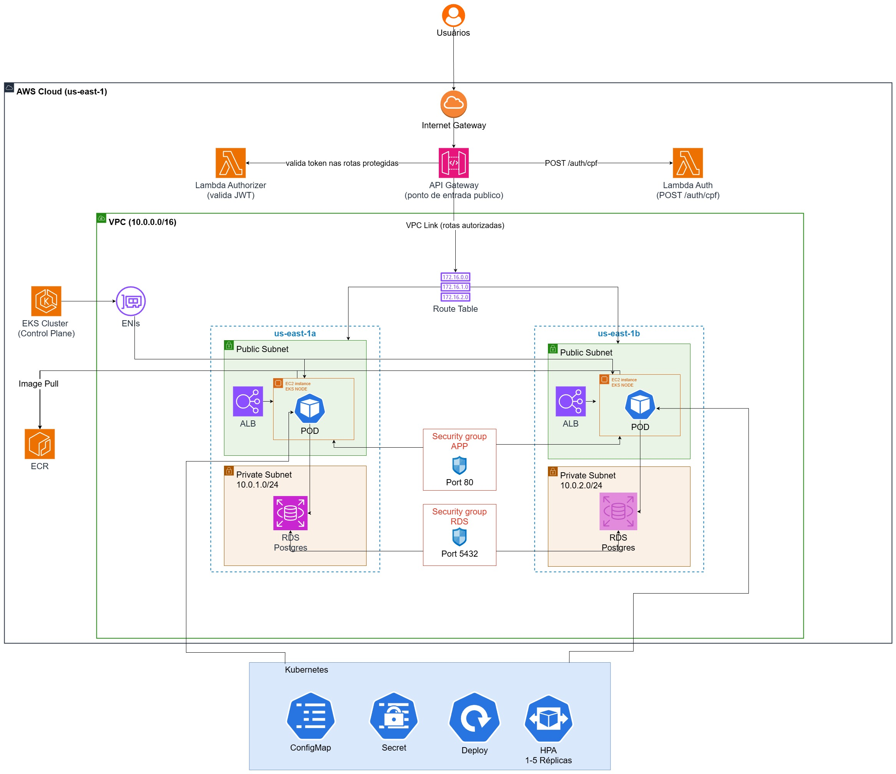
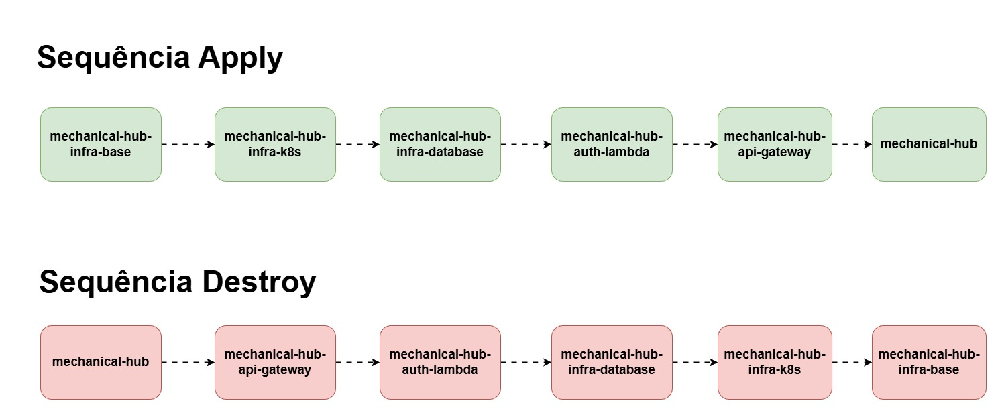

# mechanical-hub-infra-k8s

Provisiona o cluster Kubernetes (Amazon EKS) do projeto mechanical-hub: o control
plane, o node group gerenciado (com o Launch Template customizado), o acesso via
`kubectl`, as regras de segurança que conectam este cluster aos recursos criados no
`infra-base`, e a instalação via Helm do Datadog Agent, Cluster Autoscaler, EBS CSI
Driver, RabbitMQ e SonarQube (Fase 4).

## Tecnologias

- **Terraform** (`hashicorp/aws ~> 5.0`) — cluster EKS, node group, launch template, access entry, security group rules.
- **AWS EKS** — control plane gerenciado + node group gerenciado (`t3.medium`, 2 a 5 nós).
- **Helm** — instalação do Datadog Agent, Cluster Autoscaler, EBS CSI Driver, RabbitMQ e SonarQube, executada pela pipeline após o `terraform apply`.
- **GitHub Actions** — pipelines de validação (feature) e apply/destroy + instalação Helm (main).
- **kubectl** — usado pela pipeline para configurar os componentes Helm (namespace, secret da API key do Datadog).

## Diagrama de arquitetura



## Passos para execução e deploy

**Depende do `infra-base` já aplicado** (consome VPC, subnets públicas e os security
groups `app`, `rds` e `alb` via data source). Ordem completa: **infra-base →
infra-k8s → infra-database → auth-lambda → api-gateway** → `mechanical-hub` (app).
Para derrubar, ordem inversa, com este repo saindo **antes** do `infra-base`.



1. Configurar no repositório os secrets `AWS_ACCESS_KEY_ID`, `AWS_SECRET_ACCESS_KEY`,
   `AWS_SESSION_TOKEN`, `AWS_ACCOUNT_ID`, `DD_API_KEY`, `RABBITMQ_PASSWORD`,
   `RABBITMQ_ERLANG_COOKIE` e `SONAR_MONITORING_PASSCODE`.
2. Garantir que o `infra-base` já foi aplicado (VPC/subnets/SGs precisam existir).
3. No início da sessão do AWS Academy, garantir `infra/pipeline.conf` com
   `DESTROY=false` e fazer merge em `main` via PR (branch protegida, sem push direto),
   ou disparar `workflow_dispatch` manualmente.
4. A pipeline aplica o Terraform (cluster EKS, node group, access entry, regras de
   SG) e, na sequência, instala/atualiza via Helm o Datadog Agent, o Cluster
   Autoscaler, o EBS CSI Driver (pré-requisito para os volumes persistentes do
   RabbitMQ e do SonarQube), o RabbitMQ e o SonarQube no cluster recém-criado.
5. Conferir os outputs (`eks_cluster_name`, `eks_cluster_endpoint`) e, com
   `aws eks update-kubeconfig --name eks-mechanical-hub`, validar acesso via
   `kubectl get nodes`.
6. Antes da sessão do AWS Academy encerrar, mudar `infra/pipeline.conf` para
   `DESTROY=true` e fazer merge em `main` via PR.

> Atenção de ordem: depois que este repo recriar o cluster (destroy + apply), o
> `api-gateway` precisa ser reaplicado — o `aws_autoscaling_attachment` dele aponta
> para o Auto Scaling Group do node group, que ganha um nome novo a cada recriação.
> Sem reaplicar, o target group do ALB fica sem nenhum target saudável (503 na
> aplicação inteira). Confirmado ao vivo nesta fase.

## Decisões arquiteturais relacionadas

RFCs e ADRs ficam centralizados no repo da aplicação, para não duplicar/desincronizar entre os 6 repositórios. As diretamente relevantes para este repo:

- [ADR-002 — Descoberta entre repositórios via data source](https://github.com/estefanyneres/mechanical-hub/blob/main/src/docs/fase3/documentacao/adrs.md)
- [ADR-003 — Security groups centralizados em `infra-base`](https://github.com/estefanyneres/mechanical-hub/blob/main/src/docs/fase3/documentacao/adrs.md)
- [ADR-004 — ALB criado pelo Terraform, Service como NodePort](https://github.com/estefanyneres/mechanical-hub/blob/main/src/docs/fase3/documentacao/adrs.md)
- [ADR-006 — HPA e node group como duas camadas de escala; Cluster Autoscaler fora do escopo](https://github.com/estefanyneres/mechanical-hub/blob/main/src/docs/fase3/documentacao/adrs.md)
- [ADR-008 — Nodes em subnet pública sem NAT Gateway](https://github.com/estefanyneres/mechanical-hub/blob/main/src/docs/fase3/documentacao/adrs.md)
- [ADR-015 — Filtragem deliberada de ruído de observabilidade](https://github.com/estefanyneres/mechanical-hub/blob/main/src/docs/fase3/documentacao/adrs.md)

## Regras de segurança criadas aqui (consumidor do `infra-base`)

Duas regras que só podem existir depois que o cluster EKS já foi criado (o SG
automático do cluster só existe nesse momento — por isso não podem viver no
`infra-base`):

| Regra | De → Para | Motivo |
|-------|-----------|--------|
| `eks_cluster_sg_to_rds` | SG automático do cluster EKS → SG do RDS (porta 5432) | Os nodes/pods do EKS usam o SG automático do cluster, não o SG `app` do `infra-base`, então precisam de liberação própria para alcançar o banco |
| `alb_to_eks_cluster_sg_nodeport` | SG do ALB (`infra-base`) → SG automático do cluster EKS (porta 30080) | O ALB do `api-gateway` encaminha para os nodes na porta NodePort |

## Datadog Agent

Instalado via Helm (`datadog/datadog`) pela pipeline, com `datadog/datadog-values.yaml`
deste repo. Configuração de observabilidade deliberada: `DD_APM_IGNORE_RESOURCES`
filtra `GET /actuator/health` dos traces de APM, e `containerExcludeLogs` exclui os
namespaces `datadog` e `kube-system` da coleta de logs — ambos ruído de
infraestrutura, não tráfego real da aplicação.

## Outputs publicados

| Output                 | Descrição                        |
|-------------------------|-----------------------------------|
| `eks_cluster_name`      | Nome do cluster EKS              |
| `eks_cluster_endpoint`  | Endpoint de acesso ao cluster EKS |

## Pipelines

- `pipeline-infra-feature.yml`: dispara em push para `feature/*`. Roda
  `terraform fmt -check`, `init -backend=false` e `validate`. Abre PR automático
  para `main` se tudo passar.
- `pipeline-infra-main.yml`: dispara em push para `main` (ou `workflow_dispatch`).
  Lê `infra/pipeline.conf` e aplica ou destrói o Terraform conforme `DESTROY`.
  Quando `DESTROY=false`, os jobs de instalação via Helm rodam depois do apply:
  Datadog Agent e Cluster Autoscaler (em paralelo), EBS CSI Driver, e então
  RabbitMQ e SonarQube (que dependem do EBS CSI Driver já estar pronto, por
  causa dos volumes persistentes). Por fim, `sonarqube-bootstrap` gera um token
  de autenticação novo e publica no resumo do job, pra copiar manualmente nos
  4 repositórios de microsserviço.

## Estrutura

```
mechanical-hub-infra-k8s/
├── .github/workflows/
│   ├── pipeline-infra-feature.yml
│   └── pipeline-infra-main.yml
├── cluster-autoscaler/
│   └── values.yaml
├── datadog/
│   └── datadog-values.yaml
├── rabbitmq/
│   └── values.yaml
├── sonarqube/
│   └── values.yaml
├── docs/
│   └── desenhos/
│       ├── mechanical-hub-infraestrutura-fase-03.jpg
│       └── mechanical-hub-apply-destroy-repos-fase-03.jpg
├── infra/
│   ├── providers.tf
│   ├── variables.tf
│   ├── data.tf
│   ├── eks.tf
│   ├── access-entry.tf
│   ├── sg_rules.tf
│   ├── outputs.tf
│   └── pipeline.conf
├── .gitignore
└── README.md
```
